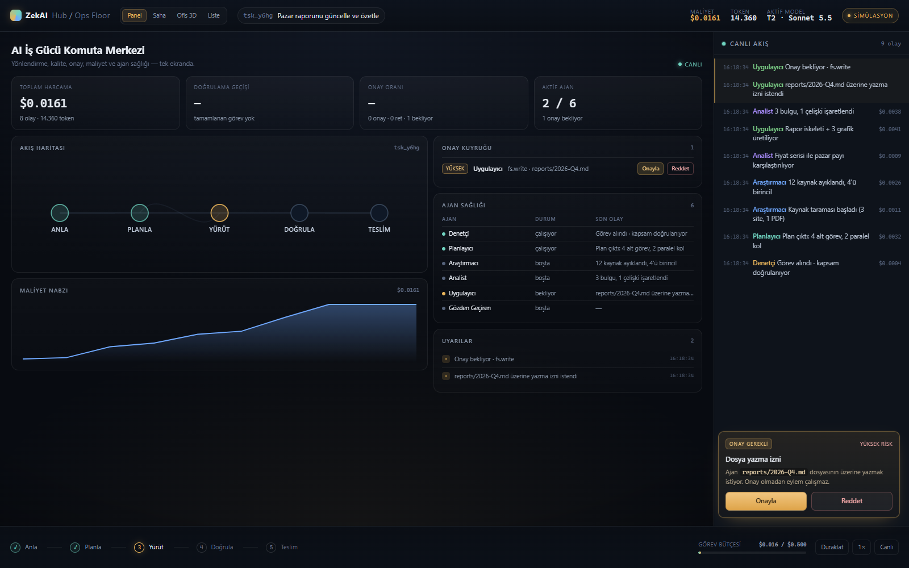
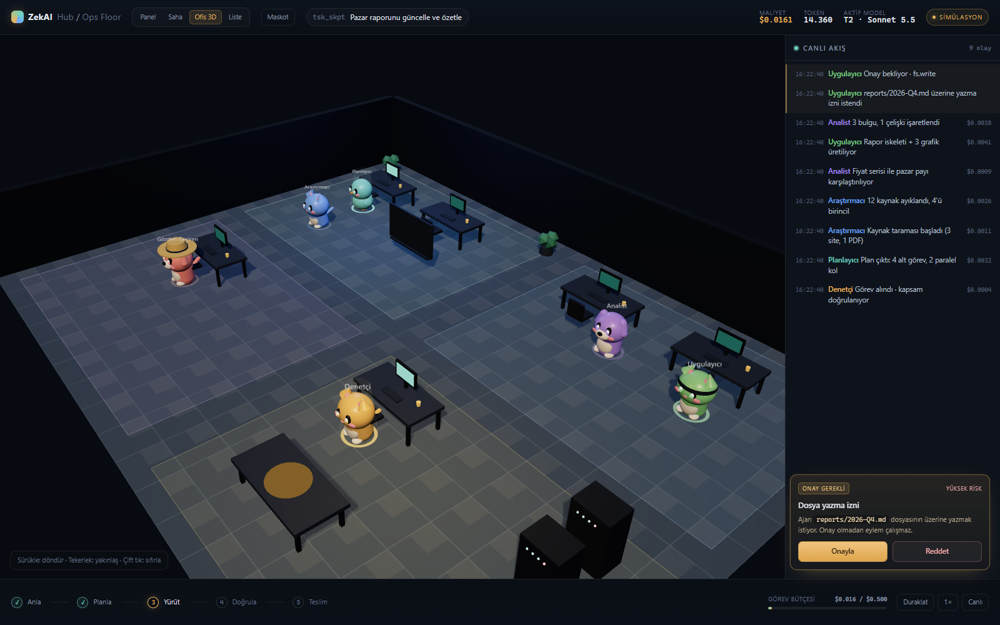

# ZekAI Hub

Lean Hybrid Agent Swarm için çalışma deposu: sistem mimarisi, çalışan **Ops Floor** arayüzü
ve tek tık kurulum. Çekirdek tasarım `LEAN_HYBRID_AGENT_SWARM_ARCHITECTURE.md` dosyasında;
arayüz kararı `docs/ADR-011-sunum-katmani.md` içinde.



## Üç görünüm, tek olay hattı

| Görünüm | Ne gösterir | Teknoloji |
|---|---|---|
| **Panel** (varsayılan) | KPI, akış haritası, onay kuyruğu, maliyet nabzı, ajan sağlığı | DOM/SVG |
| **Görevler** | Verdiğin görevler: plan (ajan + model katmanı), durum, süre, maliyet, sonuç | DOM |
| **Saha** | 2.5D izometrik ofis; ajanlar, bölgeler, olay balonları | Canvas 2D, bağımlılıksız |
| **Ofis 3D** | Prosedürel chibi karakterler, döndürülebilir kamera, GLB model desteği | three.js (lazy, ayrı modül) |
| **Liste** | Erişilebilir kart görünümü (ekran okuyucu/klavye) | DOM |

Üstteki **Panel · Görevler · Saha · Ofis 3D · Liste** düğmesiyle geçilir (`V`), tercih tarayıcıda saklanır.
Açık/koyu tema: üstteki güneş/ay düğmesi (`T`); tema 3D sahneyi de değiştirir (gündüz/gece).



3D modeller harici dosya gerektirmez; karakterler kodla üretilir. Kendi GLB/glTF modelinizi
`apps/ops-floor/models/` klasörüne koyup **Maskot** panelinden karaktere atayabilirsiniz
(lisans koşulları size aittir — bkz. `apps/ops-floor/models/README.md`).

## Maskot paneli

`Maskot` düğmesi (veya `M`): görev rollerine karakter atama, katalogdan ekleme/çıkarma,
ad/tür (kedi, köpek, kuş), aksesuar (bandana, şapka, dikenli saç) ve renk seçimi.
Değişiklikler anında 3D sahneye uygulanır ve tarayıcıda saklanır. Bir karakter silinirse
ona atanmış roller otomatik olarak kalan ilk karaktere geçer.

Katalogdaki hazır karakterler **özgün arketiplerdir**; telifli karakterlerin birebir
modelleri repoya dahil edilmez. Kendi karakterinizi ekleyebilir veya lisansı uygun bir
GLB model bağlayabilirsiniz.

## Görev verme ve yönlendirme

Mesaj alanı **ekranın altındaki kalıcı panel**dir; her görünümde açıktır (Enter gönder,
Shift+Enter satır, `G` odaklan). Panelde ayrıca geçmiş konuşma ve **Görevler** sekmesi var.

İş önce **Denetçi**'ye gider; sonra konuya göre bir **plan** çıkar ve alt ajanlara dağıtılır:

```
Sen → Denetçi → Planlayıcı (T3) / Araştırmacı (T1) / Analist (T2) / Uygulayıcı (T2) / Gözden Geçiren (T1)
```

- Plan ve her adımın **model katmanı** alt paneldeki rozetinde ve görev detayında görünür.
- Katman → model eşlemesi **Ayarlar → T1/T2/T3** alanlarından yapılır; boşsa tek model kullanılır.
- İlk istemde otomatik demo senaryosu durur; başlık ve olaylar senin görevine geçer.
- Yönlendirme şimdilik **kural tabanlı bir demo**dır; gerçek platformda Supervisor + Policy Engine verir.

## Bağlantı ayarları

Panelin altındaki **Görev konsolu**'ndan istem gönderilir; yanıt ofiste olay olarak akar
(maliyet/token sayacı gerçek yanıttan gelir). **Bağlantı ayarları**: sağlayıcı
(Mock / OpenAI-uyumlu / Anthropic), model, base URL ve API anahtarı.

- **Mock** anahtarsız çalışır; akışı hemen denemek için varsayılandır.
- Anahtar tarayıcıya değil, yerel sunucuya gönderilir ve `~/.zekai/config.json` içinde
  saklanır; API yanıtlarında asla geri dönmez.
- Bu bir prototiptir: dosya diskte düz metindir. Üretimde OS keychain / Secret Vault
  (ADR-005, §17) zorunludur; anahtarı repoya veya `.env`'e koymayın.
- Sağlayıcı çağrıları sunucu tarafından yapılır (CORS ve anahtar sızması önlenir).

## Hızlı başlangıç

```powershell
# Windows tek tık: ZekAI-Setup.cmd dosyasına çift tıkla
# veya:
.\Swarm.ps1 install        # kurulum + masaüstü kısayolu + başlat
.\Swarm.ps1 start          # sunucuyu aç, tarayıcıya git
.\Swarm.ps1 doctor         # sistem teşhisi
.\Swarm.ps1 uninstall      # kısayolları kaldır
```

```powershell
# Geliştirici:
python tools/swarm_sim.py serve --port 8787   # http://127.0.0.1:8787/
python tools/swarm_sim.py run --speed 2       # aynı olaylar, terminalde
python tools/swarm_sim.py check events.jsonl  # şema doğrulama
```

Kurulum sihirbazı Python 3.10+ arar; başka bağımlılık kurmaz (CLI ve sunucu stdlib).
Docker gerekmez. Ayrıntı: `installer/README.md`.

**Tek tık:** `installer\windows\ZekAI-Setup.cmd` → masaüstü kısayolu + kontrol paneli.
**Kontrol paneli:** `installer\windows\ZekAI.cmd` — başlat / durdur / yeniden başlat / log / teşhis (WinForms, ek bağımlılık yok).
Komut satırı: `.\Swarm.ps1 install | start | gui | doctor | uninstall`.

### URL parametreleri

| Parametre | Etki |
|---|---|
| `?live=1` | SSE'ye bağlan, geçmişi yeniden oynat |
| `?view=dash\|floor\|office\|list` | Görünümü seç |
| `?panel=1` | Maskot panelini aç |
| `?warp=10` | Sahneyi 10 saniye ileri sar (demo/screenshot) |

Klavye: `Space` duraklat · `1/2/3` hız · `V` görünüm · `K` liste · `L` canlı · `M` maskot.

## Yapı

```
apps/ops-floor/          # Panel + 2.5D + 3D + maskot paneli
  vendor/                # three.js + GLTFLoader (yerel, CDN'siz)
  models/                # kullanıcı GLB modelleri
tools/swarm_sim.py       # olay üreteci, CLI, SSE, şema doğrulayıcı
installer/windows/       # tek tık kurulum + başlatıcı + kaldırma
docs/                    # ADR'ler ve ekran görüntüleri
```

## Mimari özet (tek cümle)

**Arayüz, `domain_events` hattının projeksiyonudur:** CLI kontrol düzlemidir, Panel/3D
gözlem düzlemidir; hiçbir renderer domain state yazmaz, yalnızca niyet gönderir. Onay,
bütçe ve yetki kararları her zaman API/Policy tarafındadır.

## Bilinçli sınırlar

- Prototip: kimlik, tenant, veritabanı ve gerçek model çağrısı yok; maliyet sayıları temsilî.
- SSE sunucusu yalnızca yerel geliştirme içindir (`127.0.0.1`), CORS bu yüzden açıktır.
- 3D karakterler stilize/özgündür; varlıklı (GLB) sahneler P3+ kapsamındadır.
- Ölçülen hedefler: 2.5D < 60 KB, 3D modülü ~1,1 MB (three.js dahil), ilk 3D açılışı < 1 s.
